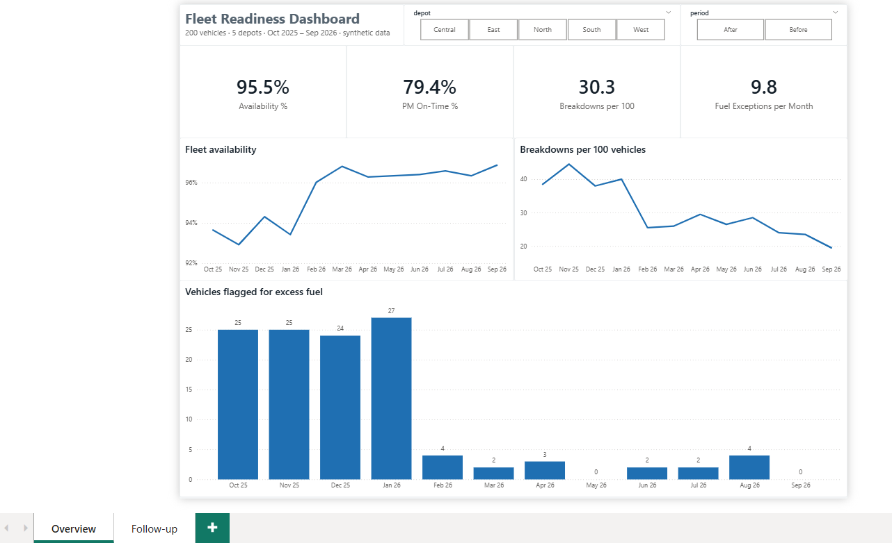
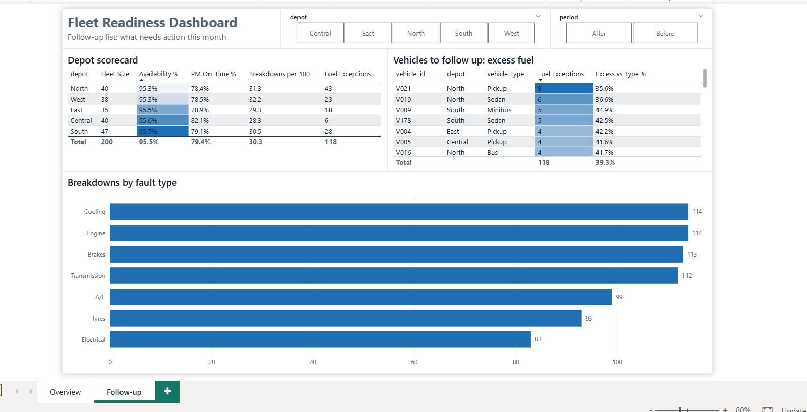

# Fleet Readiness Dashboard

A Power BI report for a fleet manager's monthly review: is the fleet available, is maintenance on schedule, which depots are falling behind, and which vehicles burn more fuel than they should.

Built on a **synthetic fleet of 200 vehicles across 5 depots**, October 2025 to September 2026. Maintenance and fuel controls start in February 2026, so every page can be filtered to compare **before** and **after**. The approach comes from running fleet and dispatch operations; **the data is generated and describes no real fleet**.



## Results

| KPI | Before (Oct–Jan) | After (Feb–Sep) |
|---|---:|---:|
| Fleet availability | 93.6% | 96.5% |
| Preventive maintenance on time | 57.6% | 92.9% |
| Breakdown jobs per 100 vehicles / month | 40.3 | 25.4 |
| Vehicles flagged for excess fuel / month | 25.3 | 2.1 |

Once preventive services run on schedule, breakdowns fall by more than a third. Per-vehicle fuel monitoring removes almost all fuel exceptions within one month.

## Report pages

**Overview:** the four headline KPIs and their monthly trends, filtered by depot and period.

**Follow-up:** what needs action. A depot scorecard, the vehicles flagged for excess fuel ranked by how many months they were flagged and how far above their type they run, and breakdowns by fault type.



## Data model

A star schema with two dimensions and three fact tables, one-to-many relationships in a single direction.

| Table | Grain | Rows |
|---|---|---:|
| `dim_vehicle` | One vehicle: depot, type, model year | 200 |
| `dim_date` | One month, with Before / After period | 12 |
| `fact_usage` | Vehicle × month: km, fuel, days available | 2,400 |
| `fact_maintenance` | One workshop job, preventive or corrective | 1,467 |
| `fact_pm` | One preventive service due, done on time or not | 931 |

## DAX

Fuel is compared **within vehicle type**: a truck is compared with trucks, not with sedans. A vehicle is flagged when it runs more than 15% above its type median for the month.

```dax
// Calculated column: median L/100 km of the same type in the same month
Type Median =
VAR ThisMonth = fact_usage[month_date]
VAR ThisType  = RELATED ( dim_vehicle[vehicle_type] )
RETURN
    MEDIANX (
        FILTER ( fact_usage,
            fact_usage[month_date] = ThisMonth
                && RELATED ( dim_vehicle[vehicle_type] ) = ThisType
                && fact_usage[km] > 0 ),
        fact_usage[L per 100 km] )

// Calculated column
Fuel Flag =
IF ( fact_usage[km] > 0 && fact_usage[L per 100 km] > fact_usage[Type Median] * 1.15, 1, 0 )

// Measure: monthly average, so it reads the same for one month or a whole year
Breakdowns per 100 =
AVERAGEX ( VALUES ( dim_date[month_date] ), DIVIDE ( [Breakdowns], [Fleet Size] ) * 100 )

// Measure: how far flagged vehicles run above their type
Excess vs Type % =
AVERAGEX (
    FILTER ( fact_usage, fact_usage[Fuel Flag] = 1 ),
    DIVIDE ( fact_usage[L per 100 km], fact_usage[Type Median] ) - 1 )
```

All measures: [`fleet-powerbi-kit/powerbi/measures.dax`](fleet-powerbi-kit/powerbi/measures.dax)

## Files

```text
fleet-readiness-dashboard/
├── fleet_readiness.pbix            Power BI report (Overview and Follow-up pages)
├── powerbi_overview.png
├── powerbi_followup.png
└── fleet-powerbi-kit/
    ├── measures_query_view.dax     All measures in one block for DAX query view
    └── powerbi/
        ├── measures.dax            Calculated columns and measures
        ├── fleet_theme.json        Report theme
        └── data/                   The five star-schema tables (CSV)
```

Open `fleet_readiness.pbix` in Power BI Desktop. If it asks for the data, point it to `fleet-powerbi-kit/powerbi/data/`.

## About

Built by **Sherief Nooh**, supply chain, logistics and security operations professional and former Major in the Egyptian Ministry of Interior, where I directed fleet and dispatch operations for 200+ vehicles.

[Portfolio](https://sherief-nooh.github.io) · [LinkedIn](https://www.linkedin.com/in/sherief-nouh/) · [GitHub](https://github.com/sherief-nooh)
